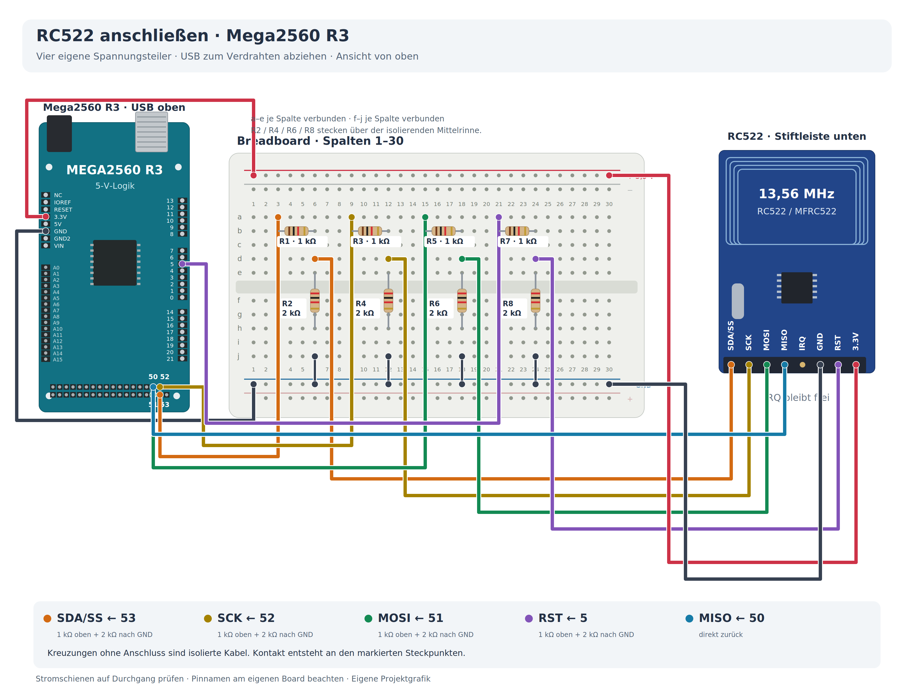
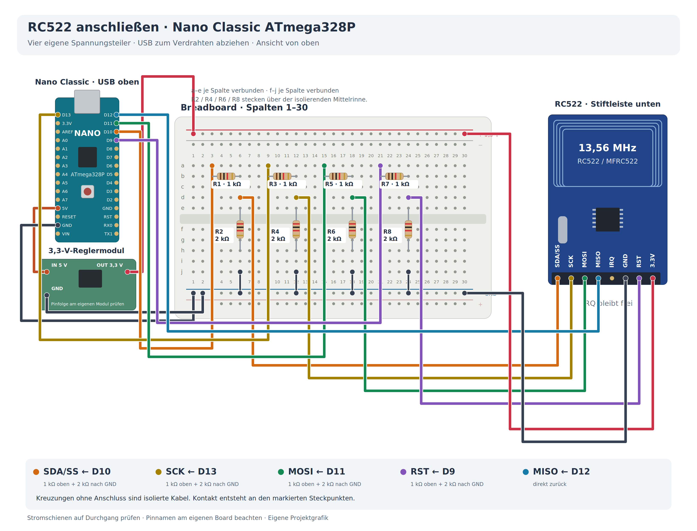
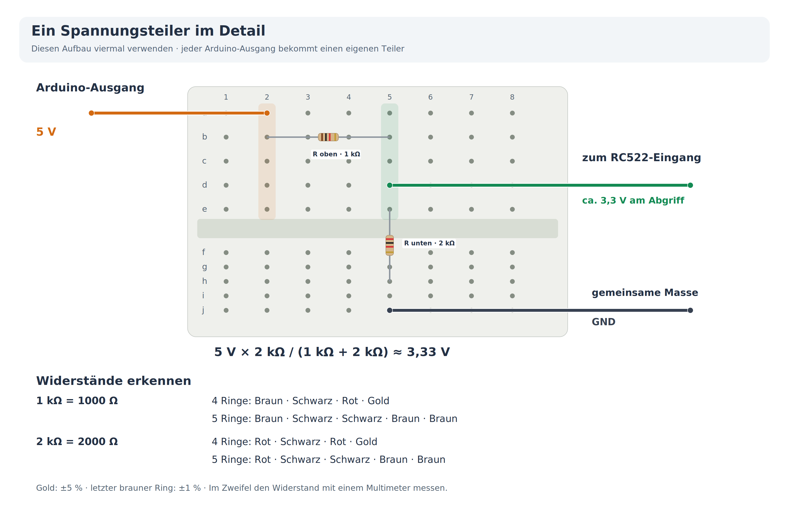

# Arduino und RC522 – CFS Tagwriter 3.5.1

## Teile

- Elegoo/Arduino Mega2560 R3 **oder** Nano Classic ATmega328P, 5 V, 16 MHz.
- RC522/MFRC522-SPI-Modul, Breadboard, kurze Steckleitungen, USB-Datenkabel.
- Vier Widerstände mit 1 kΩ und vier mit 2 kΩ.
- Beim Nano: geregeltes 3,3-V-Versorgungsmodul für mindestens 100 mA,
  geeignet für 5-V-Eingang; dessen Pinbelegung laut Datenblatt prüfen.
- MIFARE Classic 1K mit 4-Byte-UID. NTAG-Aufkleber sind dafür ungeeignet.

## Bebilderter Aufbau

Die folgenden Kabelbilder sind eigene Projektgrafiken. Es wurden keine
Fritzing-, Arduino- oder Händlerbilder übernommen. Die Grafiken stehen wie der
eigene Projektcode unter PolyForm Noncommercial 1.0.0. Die Pinbelegung richtet
sich nach den unten verlinkten Herstellerunterlagen.

### Mega2560 R3



[Vergrößerbare SVG-Grafik für den Mega](../app/creality-cfs-writer/hardware-assets/mega2560-breadboard.svg)

### Nano Classic ATmega328P



[Vergrößerbare SVG-Grafik für den Nano](../app/creality-cfs-writer/hardware-assets/nano328p-breadboard.svg)

### Widerstände und Steckbrett verstehen



[Vergrößerbare SVG-Detailgrafik](../app/creality-cfs-writer/hardware-assets/spannungsteiler-detail.svg)

Bei den dargestellten Breadboards sind **a–e einer Spalte miteinander verbunden**,
**f–j derselben Spalte ebenfalls**. Die Mittelrinne trennt die beiden Gruppen.
Die 2-kΩ-Widerstände überbrücken diese Rinne von Reihe e bis h. So bleibt Platz für Widerstandskörper und Anschlussdrähte. Die obere rote Schiene führt 3,3 V,
die untere blaue Schiene GND. Die beiden anderen Schienen bleiben frei.
Stromschienen können bei anderen Steckbrettern in der Mitte getrennt sein.
Dann die benötigten Abschnitte miteinander verbinden und auf Durchgang prüfen.

| Signal | Arduino-Kabel ins Breadboard | Oberer Widerstand · 1 kΩ | Abgriff zum RC522 | Unterer Widerstand · 2 kΩ | GND-Brücke |
| --- | --- | --- | --- | --- | --- |
| SDA/SS | a3 | b3 → b6 · R1 | d6 | e6 → h6 · R2 | j6 → GND |
| SCK | a9 | b9 → b12 · R3 | d12 | e12 → h12 · R4 | j12 → GND |
| MOSI | a15 | b15 → b18 · R5 | d18 | e18 → h18 · R6 | j18 → GND |
| RST | a21 | b21 → b24 · R7 | d24 | e24 → h24 · R8 | j24 → GND |

**1 kΩ = 1000 Ω**, **2 kΩ = 2000 Ω**. Bei vier Farbringen hat 1 kΩ
Braun–Schwarz–Rot–Gold, 2 kΩ Rot–Schwarz–Rot–Gold. Bei fünf Ringen hat
1 kΩ Braun–Schwarz–Schwarz–Braun–Braun und 2 kΩ
Rot–Schwarz–Schwarz–Braun–Braun. Die Widerstände haben keine Einbaurichtung.
Jeder Teiler liefert ungefähr 3,3 V aus dem 5-V-Arduino-Signal.

Die Abbildungen zeigen die Komponenten von oben, USB am Arduino oben und die
RC522-Stiftleiste unten. **Pinnamen am eigenen Modul prüfen**, da Nachbauten
abweichen können. Beim Nano ist der Regler symbolisch dargestellt, seine
Anschlussreihenfolge hängt vom gewählten Modul ab. Kabelkreuzungen stellen
keine elektrische Verbindung dar. Nur die markierten Endpunkte werden gesteckt.

In der App unter **Hilfe → Arduino-Bauanleitung und Schaltplan…** zwischen
Mega und Nano wählen. **+**, **−** und **Einpassen** steuern die Bildgröße.
Ein eigener Reiter zeigt den Spannungsteiler und die Widerstandsfarben.

## Verdrahtung

USB vorher abziehen. Die vier Signale **SS, SCK, MOSI, RST** brauchen jeweils
separat diesen Teiler. Die 2-kΩ-Widerstände dürfen dieselbe GND-Schiene verwenden:

```text
Arduino-Ausgang ── 1 kΩ ──┬── RC522-Eingang
                          │
                         2 kΩ
                          │
                         GND
```

| RC522 | Mega2560 R3 | Nano Classic ATmega328P | Verbindung |
| --- | --- | --- | --- |
| SDA / SS | 53 | D10 | eigener Teiler |
| SCK | 52 | D13 | eigener Teiler |
| MOSI | 51 | D11 | eigener Teiler |
| RST | 5 | D9 | eigener Teiler |
| MISO | 50 | D12 | direkt, ohne Teiler |
| GND | GND | GND | gemeinsame Masse, auch für alle Teiler |
| IRQ | frei | frei | nicht anschließen |
| 3.3V | 3.3V | Ausgang des zusätzlichen 3,3-V-Reglers | niemals 5 V an RC522 |

Am Nano den Regler-Eingang mit 5 V und dessen GND mit der gemeinsamen Masse
verbinden. Sein geregelter 3,3-V-Ausgang versorgt das RC522. Der offizielle Nano
stellt an seinem 3,3-V-Pin maximal 50 mA bereit; für einen verlässlichen Aufbau
verwenden wir hier eine separate Versorgung. Regleranschlüsse unterscheiden sich
je nach Modul. Beim Mega reicht der vorgesehene 3,3-V-Anschluss für dieses Modul.
SDA bedeutet hier SPI-Chipselect, nicht I²C. Alle Leitungen kurz halten und
Kontaktstellen vor dem Einschalten prüfen.

## Software und erster Test

Die Git-Ausgabe kompiliert die Bridge beim Upload aus Quellcode. Beim ersten Mal werden Arduino CLI 1.5.1, Arduino AVR Core 1.8.8 und MFRC522 1.4.12 eingerichtet. Dafür Internetzugriff vorsehen.

1. App öffnen, **Einstellungen → Arduino und IDE-Backup…** öffnen.
   Mega oder Nano wählen; beim Nano gegebenenfalls **alter Bootloader**.
2. USB-Port wählen, Arduino-IDE-Monitor schließen und Bridge hochladen.
   Der bisherige Arduino-Sketch wird ersetzt. Die App brennt keinen Bootloader.
3. Im Hauptfenster USB verbinden und zuerst **Tag lesen** mit der Testkarte.
   Für Schreiben ein registriertes Profil wählen und Rücklesebestätigung abwarten.

Falls der Upload nicht klappt, **Backup: Arduino-IDE-Sketch exportieren…**
wählen und den Zielordner selbst bestimmen. Die exportierte `.ino` in der IDE
öffnen, Bibliothek **MFRC522 von GithubCommunity** installieren (getestet 1.4.12),
passendes Board/Bootloader und Port auswählen und hochladen. Der serielle Monitor
benutzt 115200 Baud. Der Export allein verändert den Arduino nicht.

Die App zeigt dieselbe Anleitung samt umschaltbarem Schaltplan unter
**Hilfe → Arduino-Bauanleitung und Schaltplan…**. Nano Every, Nano 33,
Nano ESP32 und ATmega168 gehören nicht zu diesen Builds.

## Quellen

- [Mega-Pinbelegung](https://docs.arduino.cc/resources/pinouts/A000067-full-pinout.pdf)
- [Nano-Pinbelegung und 3,3-V-Grenze](https://docs.arduino.cc/resources/pinouts/A000005-full-pinout.pdf)
- [NXP MFRC522](https://www.nxp.com/docs/en/data-sheet/MFRC522.pdf)
- [Arduino-Bibliothek MFRC522](https://github.com/miguelbalboa/rfid)

Die hier enthaltene Bridge unterstützt einen RC522 pro Arduino. Der Zwei-Tag-Modus beschreibt beide Spulenseiten nacheinander. Ein ESP32-Aufbau mit zwei PN532-Lesern und Touchdisplay ist ein gesondertes geplantes Hardwareprojekt.

## Optionaler Anycubic-Modus ab 3.5.1

Die Verdrahtung ändert sich nicht. Für das experimentelle ACE-Pro-Format wird
jedoch ein **NTAG213 mit 7-Byte-UID** statt eines CFS-MIFARE-Classic-Tags benötigt.
Dafür Bridge 1.1.0 manuell aufspielen. Die neue Bridge versteht zusätzlich die
alten CFS-Befehle. Für den normalen CFS-Betrieb reicht Bridge 1.0.0 weiterhin.
